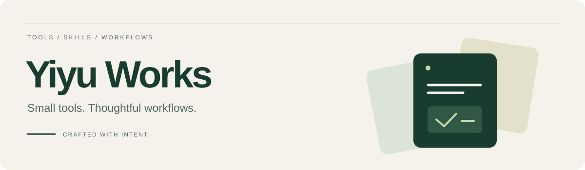

  

  <strong>把经验写成工作流，把想法做成作品。</strong> 
  Building thoughtful tools and practical Agent Skills.

  <a href="#正在构建--building">正在构建</a> ·
  <a href="#我们的标准--principles">我们的标准</a> ·
  <a href="#早期作品--earlier-work">早期作品</a>

---

### 正在构建 · Building

Yiyu Works 是一个从精品 Agent Skills 开始的个人工作室。关注独立开发者的产品界面、项目表达和发布流程，让重复工作更容易完成，让成果更容易修改和继续使用。

第一批 Skills 正在设计与验证，尚未发布。先做好少量完整工作流，再逐步扩展。

| 方向 | 希望解决的问题 | 进度 |
| :--- | :--- | :--- |
| **项目表达** | 把项目资料整理成清晰的 README，说明价值、安装与使用边界 | 规划中 |
| **界面评审** | 从真实页面发现问题，给出具体、有优先级的修改建议 | 规划中 |
| **产品发布** | 将产品资料组织成一致的落地页与发布素材 | 规划中 |

### 我们的标准 · Principles

- **完整交付** — 写清输入、输出、依赖与适用范围。
- **真实验证** — 用可复现的案例检验效果，记录限制与失败原因。
- **方便修改** — 优先交付可编辑文件，让成果能继续使用。
- **维护有界** — 明确版本、兼容环境和支持期限。

### 早期作品 · Earlier work

这里也保留了早期 Android 开发与学习记录。

- [verticaldrawerlayout](https://github.com/yiyu-works/verticaldrawerlayout) — 早期垂直抽屉组件项目。
- [CoreModule](https://github.com/yiyu-works/CoreModule) — Android 模块化参考项目，Fork 自 kymjs/CoreModule。

 

  Small tools. Thoughtful workflows. · Yiyu Works

